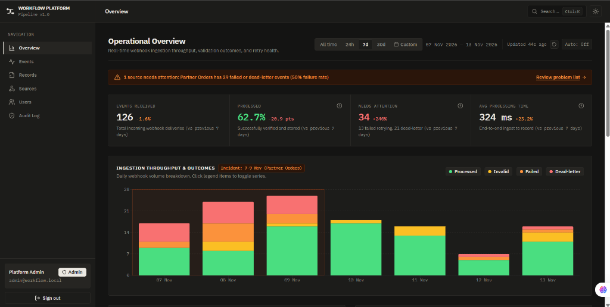
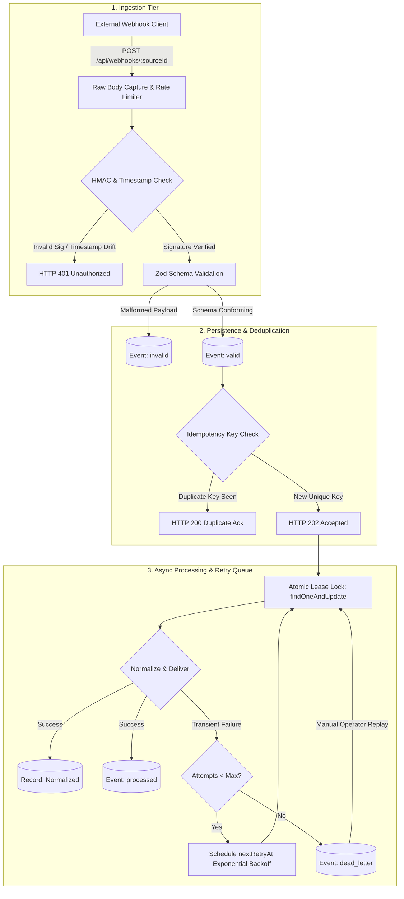

# Workflow & Data Management Platform

[](https://github.com/workflow-platform/workflow-platform/actions/workflows/ci.yml)
[](./LICENSE)
[](https://nodejs.org)
[](https://www.typescriptlang.org)
[](https://vitest.dev)

A portfolio-grade webhook ingestion pipeline, schema validation engine, asynchronous retry queue, and operational telemetry platform built with **Node.js**, **Express**, **MongoDB/Mongoose**, **React**, **TypeScript**, **Tailwind CSS**, and **Recharts**.

External systems (inbound web forms, CRM deal synchronizations, and B2B partner purchase feeds) send signed JSON webhooks to `/api/webhooks/:sourceId`. Every incoming payload undergoes raw byte capture, constant-time HMAC-SHA256 signature verification, replay-window checks, Zod schema validation, idempotency deduplication, and atomic MongoDB background processing with exponential backoff and dead-letter queueing. Authenticated operators monitor live throughput, investigate validation errors, replay failed events, and audit administrative actions through a responsive, role-aware dashboard.

---

## Visual Tour & Screenshots

<!-- Placeholder media assets stored in docs/screenshots/ -->
<div align="center">
  
  <p><em>Operational Overview: Real-time KPI summary, rolling period deltas, stacked ingestion chart, and Needs Attention triage panel.</em></p>
</div>

<div align="center">
  
  <p><em>Events Inspector: Status chips with live counts, compact idempotency keys, and right-side slide-over drawer showing raw payload and retry backoff badges.</em></p>
</div>

<div align="center">
  
  <p><em>Command Palette (Ctrl+K / Cmd+K): Fast keyboard navigation, quick event search, and light/dark theme switching.</em></p>
</div>

> **Demo Recording**: A video walkthrough of live ingestion, replay workflows, and role permissions is available in [docs/screenshots/demo.mp4](./docs/screenshots/demo.mp4).

---

## Pipeline Architecture



---

## Route Permissions Matrix

Every API endpoint enforces strict role-based access control (RBAC). The following table is generated directly from the codebase (see [docs/PERMISSIONS.md](./docs/PERMISSIONS.md)):

| HTTP Method | Path | Public | `admin` | `manager` | `viewer` | Enforcing Middleware |
|---|---|---|---|---|---|---|
| `GET` | `/api/health` | Allowed | Allowed | Allowed | Allowed | None (public liveness probe) |
| `POST` | `/api/auth/register` | Bootstrap only (`x-bootstrap-token`) | Allowed | Denied (`403`) | Denied (`403`) | `authLimiter`, `allowBootstrapOrAdmin`, `validate(registerSchema)` |
| `POST` | `/api/auth/login` | Allowed | Allowed | Allowed | Allowed | `authLimiter`, `validate(loginSchema)` |
| `POST` | `/api/auth/refresh` | Denied (`401`) | Allowed | Allowed | Allowed | `authLimiter`, `refreshSession` (token rotation + reuse invalidation) |
| `POST` | `/api/auth/logout` | Allowed | Allowed | Allowed | Allowed | Server-side refresh token revocation + cookie clearance |
| `GET` | `/api/auth/me` | Denied (`401`) | Allowed | Allowed | Allowed | `authenticate`, `authorize('admin', 'manager', 'viewer')` |
| `GET` | `/api/users` | Denied (`401`) | Allowed | Denied (`403`) | Denied (`403`) | `authenticate`, `authorize('admin')`, `validate(listUsersSchema)` |
| `GET` | `/api/users/:id` | Denied (`401`) | Allowed | Denied (`403`) | Denied (`403`) | `authenticate`, `authorize('admin')`, `validate(userIdParamSchema)` |
| `PATCH` | `/api/users/:id` | Denied (`401`) | Allowed | Denied (`403`) | Denied (`403`) | `authenticate`, `authorize('admin')`, `validate(updateUserSchema)` |
| `GET` | `/api/sources` | Denied (`401`) | Allowed | Allowed | Allowed | `authenticate`, `authorize('admin', 'manager', 'viewer')` |
| `GET` | `/api/sources/:id` | Denied (`401`) | Allowed | Allowed | Allowed | `authenticate`, `authorize('admin', 'manager', 'viewer')` |
| `POST` | `/api/sources` | Denied (`401`) | Allowed | Denied (`403`) | Denied (`403`) | `authenticate`, `authorize('admin')`, `validate(createSourceSchema)` |
| `PATCH` | `/api/sources/:id` | Denied (`401`) | Allowed | Denied (`403`) | Denied (`403`) | `authenticate`, `authorize('admin')`, `validate(updateSourceSchema)` |
| `POST` | `/api/sources/:id/rotate-secret` | Denied (`401`) | Allowed | Denied (`403`) | Denied (`403`) | `authenticate`, `authorize('admin')` |
| `GET` | `/api/events` | Denied (`401`) | Allowed | Allowed | Allowed | `authenticate`, `authorize('admin', 'manager', 'viewer')` |
| `GET` | `/api/events/:id` | Denied (`401`) | Allowed | Allowed | Allowed | `authenticate`, `authorize('admin', 'manager', 'viewer')` |
| `POST` | `/api/events/:id/replay` | Denied (`401`) | Allowed | Allowed | Denied (`403`) | `authenticate`, `authorize('admin', 'manager')` |
| `GET` | `/api/metrics/summary` | Denied (`401`) | Allowed | Allowed | Allowed | `authenticate`, `authorize('admin', 'manager', 'viewer')` |
| `GET` | `/api/metrics/timeseries` | Denied (`401`) | Allowed | Allowed | Allowed | `authenticate`, `authorize('admin', 'manager', 'viewer')` |
| `GET` | `/api/records` | Denied (`401`) | Allowed | Allowed | Allowed | `authenticate`, `authorize('admin', 'manager', 'viewer')` |
| `GET` | `/api/audit-logs` | Denied (`401`) | Allowed | Denied (`403`) | Denied (`403`) | `authenticate`, `authorize('admin')`, `validate(listAuditLogsSchema)` |
| `POST` | `/api/webhooks/:sourceId` | Signed Only (`401`) | N/A | N/A | N/A | `webhookLimiter`, `verifyWebhookSignatureAndTimestamp` |

*Security invariant*: **Zero write access for `viewer`**. Every mutating route returns HTTP `403 FORBIDDEN` when requested by a viewer.

---

## Core Engineering Decisions

### 1. Raw Body Capture & HMAC-SHA256 Verification
HMAC signatures must be calculated against the **exact bytes** sent by the client. Standard Express body parsers mutate keys, strip whitespace, or reorder JSON properties.
- **Implementation**: We hook into `express.json({ verify: (req, res, buf) => { req.rawBody = buf; } })`.
- **Replay Protection**: The `x-webhook-timestamp` header is compared against system time with a configurable tolerance window (`WEBHOOK_TOLERANCE_SECONDS=300`). Stale timestamps or future drifts are rejected with HTTP 401.
- **Timing-Safe Equality**: Signatures are evaluated using `crypto.timingSafeEqual` over fixed-length binary buffers to prevent timing side-channel attacks.
- **Encryption at Rest**: Source signing secrets cannot be one-way hashed because verification requires the secret. Secrets are encrypted at rest with **AES-256-GCM** using `SIGNING_SECRET_ENCRYPTION_KEY` and revealed only once on creation or rotation.

### 2. Idempotency Keys & Concurrency Safety
Duplicate webhook deliveries are unavoidable in distributed architectures.
- Every delivery requires an `x-idempotency-key` header.
- MongoDB enforces a unique compound index: `db.events.createIndex({ sourceId: 1, idempotencyKey: 1 }, { unique: true })`.
- If an event is re-sent (or two requests arrive concurrently), MongoDB yields an `E11000` duplicate key violation. The service catches this atomically, locates the existing event, and responds with HTTP `200 OK` + `{ duplicate: true, eventId }` without queuing duplicate work.

### 3. Mongo-Backed Retry Queue with Atomic Lease Claims
Rather than adding an external Redis/BullMQ cluster dependency, the retry worker uses MongoDB native atomic concurrency:
- **Worker Loop**: Polls every `RETRY_POLL_INTERVAL_MS` (default 2000ms).
- **Atomic Lease**: Uses `Event.findOneAndUpdate` with a lease lock filter:
  ```javascript
  const event = await Event.findOneAndUpdate(
    {
      status: { $in: ['valid', 'failed'] },
      nextRetryAt: { $lte: new Date() },
      $or: [{ lockedAt: null }, { lockedAt: { $lt: lockStaleThreshold } }],
    },
    { $set: { lockedAt: new Date() } },
    { sort: { nextRetryAt: 1 }, returnDocument: 'after' }
  );
  ```
- **Guaranteed Isolation**: Two concurrent worker processes can never acquire the same event.
- **Exponential Backoff**: Failed attempts back off exponentially: `delay = BASE_DELAY * 2^(attempts - 1)` (1s, 2s, 4s, 8s...).
- **Dead-Letter State**: When `attempts >= maxAttempts` (default 4), the event transitions to `dead_letter` and records the complete diagnostic stack in `processingLogs` for operator inspection and replay.

### 4. Token Architecture & Zero Web-Storage Leaks
- **Access Tokens**: Short-lived JWTs (15m) are held **strictly in client memory** (closure variable in `client/src/api/http.ts`). Neither `localStorage` nor `sessionStorage` contains auth tokens.
- **Refresh Cookies**: Long-lived refresh tokens (7d) are delivered inside an `httpOnly`, `SameSite=lax` cookie (`COOKIE_SECURE=true` enforced in production).
- **Server-Side Revocation**: Refresh tokens are hashed and persisted in the `refresh_tokens` collection. Logging out deletes the token record immediately; compromised token reuse invalidates the entire user session family.

### 5. Indexing & Aggregation Architecture
The analytics endpoints (`/api/metrics/summary` and `/api/metrics/timeseries`) run on MongoDB single-pass `$facet` aggregation pipelines. Compound indexes optimize status filtering, chronological queries, and text search:
- `{ sourceId: 1, status: 1, receivedAt: -1 }`
- `{ status: 1, nextRetryAt: 1 }` (worker polling index)
- Text search sanitizes user queries using `escapeRegex` to prevent ReDoS attacks. Full explain plans and index verification are detailed in [docs/INDEXES.md](./docs/INDEXES.md).

---

## Quickstart & Local Setup

### 1. Prerequisites
- **Node.js** `>= 20.0.0` (verified on `v24.19.0`)
- **MongoDB** Community Server running locally on `127.0.0.1:27017` (or MongoDB Atlas URI)

### 2. Installation
Clone the repository and install dependencies in both workspaces:

```powershell
npm --prefix server install
npm --prefix client install
```

### 3. Environment Configuration
Copy the template files:

```powershell
Copy-Item server/.env.example server/.env
Copy-Item client/.env.example client/.env
```

Ensure `server/.env` contains your development configuration:
```ini
NODE_ENV=development
PORT=4000
MONGODB_URI=mongodb://127.0.0.1:27017/workflow_platform
CLIENT_ORIGIN=http://localhost:5173
JWT_ACCESS_SECRET=0123456789abcdef0123456789abcdef0123456789abcdef
JWT_REFRESH_SECRET=fedcba9876543210fedcba9876543210fedcba9876543210
SIGNING_SECRET_ENCRYPTION_KEY=0123456789abcdef0123456789abcdef0123456789abcdef
BOOTSTRAP_TOKEN=bootstrap_admin_token_2026_secure
COOKIE_SECURE=false
COOKIE_SAME_SITE=lax
```

### 4. Seed Database (Incident + 14-Day Timeline)
Seed the database with users, webhook sources, and a realistic 14-day history featuring an outage incident on partner purchase feeds:

```powershell
npm run seed -- --reset
```

> **Credentials**: The seed script prints the generated passwords to stdout. No passwords are hardcoded in the source code. You can optionally set `SEED_ADMIN_PASSWORD`, `SEED_MANAGER_PASSWORD`, and `SEED_VIEWER_PASSWORD` in your shell environment before seeding.

### 5. Start the Application
Start the backend and frontend development servers in separate terminals:

```powershell
# Terminal 1 — Backend API and background retry worker (http://localhost:4000)
npm run dev:server

# Terminal 2 — React + Vite frontend dashboard (http://localhost:5173)
npm run dev:client
```

Open **http://localhost:5173** and log in with your seeded administrator credentials.

---

## Simulating Live Webhooks

### A. Comprehensive Test Suite Simulator
Test all edge cases (valid deliveries, malformed schemas, invalid signatures, duplicate idempotency keys, and downstream retry recovery):

```powershell
$env:ADMIN_EMAIL="admin@workflow.local"
$env:ADMIN_PASSWORD="<your-admin-password>"
npm run simulate
```

### B. Continuous Live Stream Simulator
Stream realistic signed webhooks continuously across all 3 sources (with occasional errors) to observe real-time dashboard updates:

```powershell
$env:ADMIN_EMAIL="admin@workflow.local"
$env:ADMIN_PASSWORD="<your-admin-password>"
npm run simulate:live
```

---

## Empirical Benchmark & Verification Results

All numbers below were measured during verified test executions on the development machine (12th Gen Intel Core i7-12700H, 20 vCPUs, 16.78 GB RAM, Windows 11, Node v24.19.0, local MongoDB):

### Test Suites & Coverage
| Suite | Tests | Result | Statements | Branches | Functions | Lines |
|---|---|---|---|---|---|---|
| **Server** (`mongodb-memory-server`) | 36 passed | **100% Pass** | **91.07%** | 67.29% | 94.11% | **91.07%** |
| **Client** (Vitest + JSDOM) | 11 passed | **100% Pass** | **61.16%** | 65.09% | 49.20% | **61.16%** |
| **Total** | **47 passed** | **0 failures** | — | — | — | — |

- **Coverage Weak Areas**:
  - `server`: `config/db.js` (0% — production DB connector; tests run against in-memory Mongo), `services/userService.js` (79.74% — user deactivation branches).
  - `client`: Admin sub-pages (`UsersPage.tsx` 3.12%, `AuditLogsPage.tsx` 4.34%, `RecordsPage.tsx` 4.26%) not deep-linked in the primary navigation suite. Core flows (`OverviewPage.tsx` 82.25%, `EventsPage.tsx` 84.95%, `LoginPage.tsx` 98.59%, `EventDrawer.tsx` 89.74%) have high coverage.

### Performance Benchmarks
Detailed benchmarks are recorded in [docs/PERFORMANCE.md](./docs/PERFORMANCE.md):
- **Health Endpoint (`GET /api/health`)**: **5,732.9 req/sec** (p50: 3.07ms, p95: 6.16ms, p99: 10.77ms).
- **Full Ingestion Pipeline (`POST /api/webhooks/:id`)**: **66.5 req/sec** sequential throughput with full HMAC verification, Zod validation, and MongoDB write (p50: 15.42ms, p95: 16.88ms, p99: 19.51ms).
- **Rate Limit Safeguards**: Webhooks enforce a ceiling of 1,000 requests/minute per IP, rejecting floods with HTTP 429 `WEBHOOK_RATE_LIMITED`.

### Quality & Security Audits
- **ESLint**: 0 errors, 0 warnings across `server/` and `client/`.
- **Prettier**: 100% compliant across all TypeScript, JavaScript, and CSS files.
- **Production Dependencies**: 0 vulnerabilities via `npm audit --omit=dev`.
- **Credential Hygiene**: Git tracking verified clean; zero `.env`, `node_modules`, or build artifacts tracked.

---

## Limitations & Production Considerations

1. **Single-Instance Worker**: The background retry loop runs as an in-process timer in `server/src/jobs/eventWorker.js`. While `Event.findOneAndUpdate` makes horizontal clustering safe against double-processing, high-scale production systems with hundreds of thousands of events/sec typically benefit from dedicated partition queues (e.g., Apache Kafka or AWS SQS + BullMQ).
2. **Demo-Grade Bootstrap**: The initial administrator account relies on a single-use `BOOTSTRAP_TOKEN` or the CLI seed script. In enterprise deployments, onboarding typically integrates with an external SSO/SAML identity provider.
3. **Stubbed Downstream Destination**: The normalization stage stores mapped records in the local MongoDB `records` collection. In real-world enterprise architectures, normalized records are delivered downstream to external systems (Salesforce, HubSpot, ERP SAP APIs, or Snowflake warehouses).
4. **Dev-Only Audit Findings**: While runtime dependencies are 100% clean, development-only build tooling (`vitest`, `@vitest/coverage-v8`, `typescript-eslint`) contains upstream advisory notices regarding transitive dependencies (`tinypool`, `minimatch`). These tools are excluded from production builds.
5. **No Docker Packaging**: Docker is not installed on this workstation environment. The application runs natively with Node.js 20+ and MongoDB Community, and can be containerized using standard Alpine Node.js multi-stage Dockerfiles when deploying to cloud container platforms.

---

## License

This project is licensed under the terms of the [MIT License](./LICENSE).
